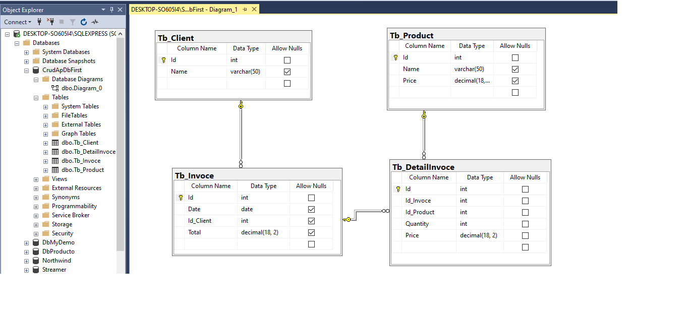
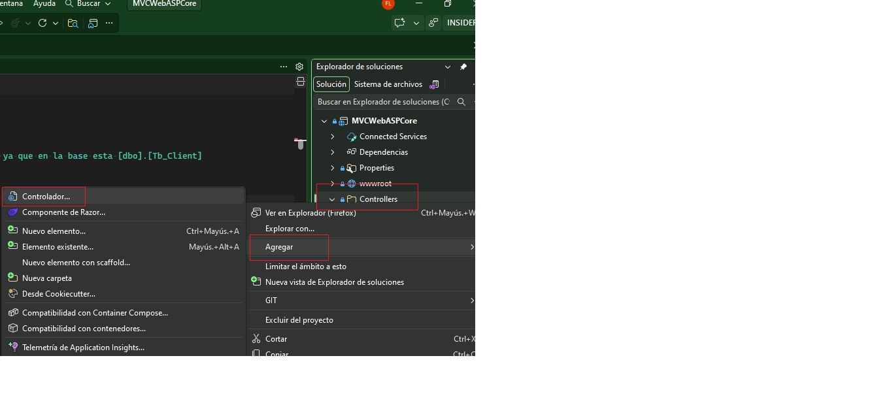
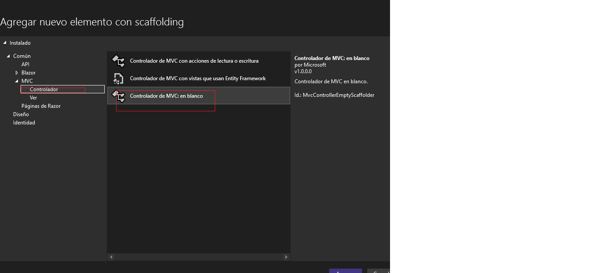
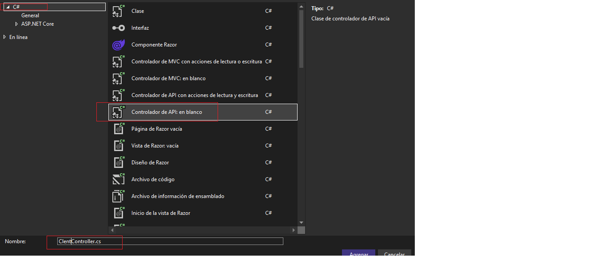
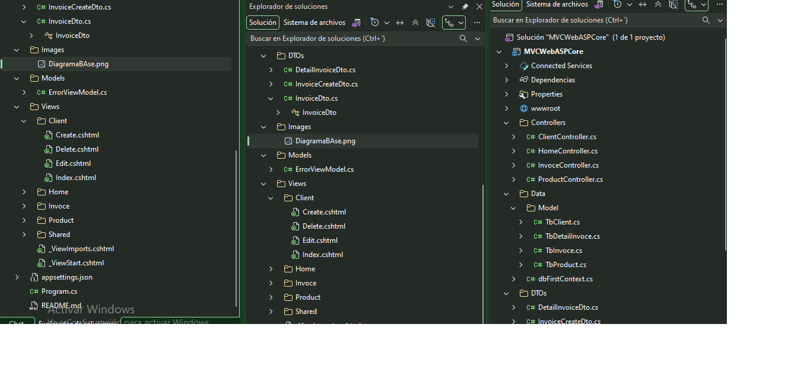
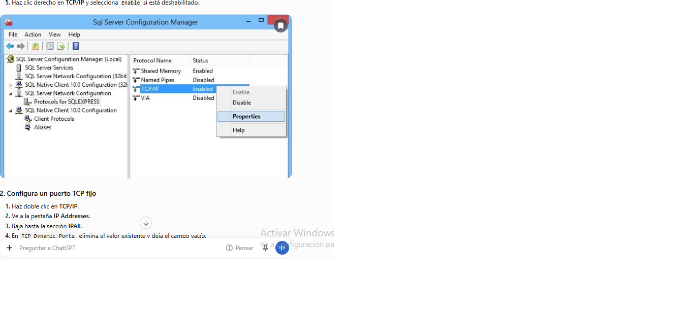
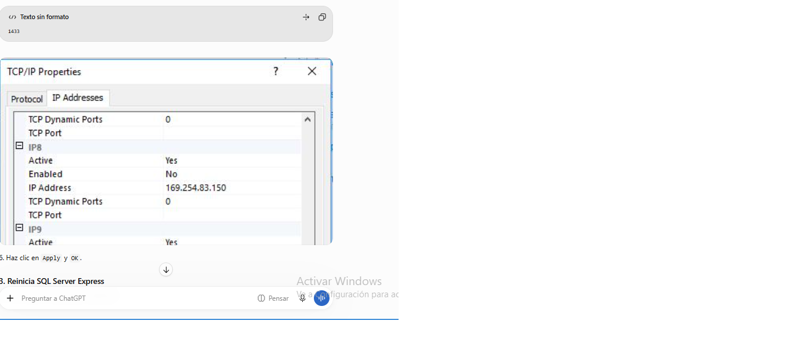
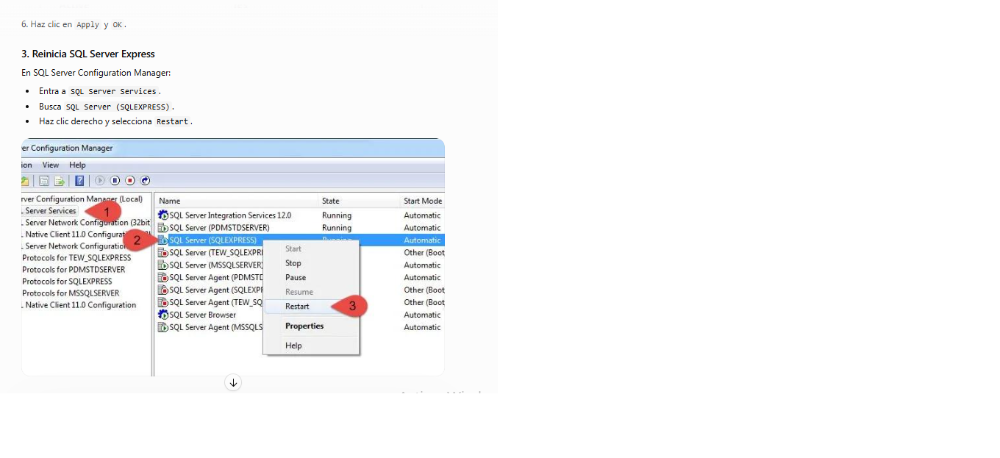

# Relaciones en Entity Framework Core con ASP.NET Core MVC Client-Product-Invoce-Tb_DetailInvoce
## Base de Datos CrudApDbFirst Sql Server
## Tecnologías utilizadas
<details> 


<summary>Ver Tecnologías utilizadas</summary>

- C#
- .NET 10
- SQL Server
- Entity Framework Core
- Database-First
- MVC Client Razor
- Visual studio 2026 IDE (Desarrollo)

</details>


<details>

<summary>Ver comandos de instalación Packages</summary>

```Terminal p consola de paquetes...

  dotnet list package
  > Microsoft.EntityFrameworkCore                10.0.1       10.0.1  
  > Microsoft.EntityFrameworkCore.SqlServer      10.0.1       10.0.1  
  > Microsoft.EntityFrameworkCore.Tools          10.0.1       10.0.1  
  > System.Security.Cryptography.Pkcs            9.0.21       9.0.21   
```

</details>

<details>

<summary>Ver Diagrama de base de datos</summary>



</details>

<details> 

<summary>Ver Script de toda la base con esquema y data</summary>

🔗 [Ver código ScriptSqlDataBaseCrudApDbFirst.sql](ScriptSqlDataBaseCrudApDbFirst.sql)

</details>

<details>
<summary>🎥 Ver Video Explicativo</summary>

[Ver video en YouTube](https://www.youtube.com/watch?v=YvUhmQh74Gw)

</details>

<details>

<summary>Ver Agregamos un nuevo Api controlador en blanco  Cliento de  Tb_Client</summary>




</details>

<details> 

<summary>Ver estructura del projecto </summary>



</details>

<details> 

<summary>Ver Controladores  ClientController</summary>

🔗 [Ver código ClientController.cs](MVCWebASPCore/Controllers/ClientController.cs)

</details>

<details> 

<summary>Ver Controladores  InvoceController</summary>

🔗 [Ver código InvoceController.cs](MVCWebASPCore/Controllers/InvoceController.cs)

</details>

<details> 

<summary>Ver Controladores  ProductController</summary>

🔗 [Ver código ProductController.cs](MVCWebASPCore/Controllers/ProductController.cs)

</details>


<details>

<summary>Ver Modelos TbClient </summary>

🔗 [Ver código TbClient.cs](MVCWebASPCore/Data/Model/TbClient.cs)

</details>

<details>

<summary>Ver Modelos TbProduct </summary>

🔗 [Ver código TbProduct.cs](MVCWebASPCore/Data/Model/TbProduct.cs)

</details>

<details>

<summary>Ver Modelos TbDetailInvoce </summary>

🔗 [Ver código TbDetailInvoce.cs](MVCWebASPCore/Data/Model/TbDetailInvoce.cs)

</details>

<details>

<summary>Ver Modelos TbInvoce </summary>

🔗 [Ver código TbInvoce.cs](MVCWebASPCore/Data/Model/TbInvoce.cs)

</details>

<details>

<summary>Ver Modelos dbFirstContext </summary>

🔗 [Ver código dbFirstContext.cs](MVCWebASPCore/Data/dbFirstContext.cs)

</details>

<details>

<summary>Ver DTOs DetailInvoiceDto </summary>

🔗 [Ver código DetailInvoiceDto.cs](MVCWebASPCore/DTOs/DetailInvoiceDto.cs)

</details>

<details>

<summary>Ver DTOs InvoiceCreateDto </summary>

🔗 [Ver código InvoiceCreateDto.cs](MVCWebASPCore/DTOs/InvoiceCreateDto.cs)

</details>

<details>

<summary>Ver DTOs InvoiceDto </summary>

🔗 [Ver código InvoiceDto.cs](MVCWebASPCore/DTOs/InvoiceDto.cs)

</details>

<details>

<summary>Ver DTOs InvoiceDto </summary>

🔗 [Ver código InvoiceDto.cs](MVCWebASPCore/DTOs/InvoiceDto.cs)

</details>

<details>

<summary>Ver Views  TbClient-Create</summary>

🔗 [Ver código TbClient-Create.cshtml](MVCWebASPCore/Views/Client/Create.cshtml)

</details>

<details>

<summary>Ver Views  TbClient-Edit</summary>

🔗 [Ver código TbClient-Edit.cshtml](MVCWebASPCore/Views/Client/Edit.cshtml)

</details>

<details>

<summary>Ver Views  TbClient-Delete</summary>

🔗 [Ver código TbClient-Delete.cshtml](MVCWebASPCore/Views/Client/Delete.cshtml)

</details>

<details>
<summary>Ver Views  TbClient-Index</summary>

🔗 [Ver código TbClient-Index.cshtml](MVCWebASPCore/Views/Client/Index.cshtml)

</details>

<details>

<summary>Ver Views  TbInvoce-Create</summary>

🔗 [Ver código TbInvoce-Create.cshtml](MVCWebASPCore/Views/Invoce/Create.cshtml)

</details>

<details>

<summary>Ver Views  TbInvoce-Edit</summary>

🔗 [Ver código TbInvoce-Edit.cshtml](MVCWebASPCore/Views/Invoce/Edit.cshtml)

</details>

<details>

<summary>Ver Views  TbInvoce-Delete</summary>

🔗 [Ver código TbInvoce-Delete.cshtml](MVCWebASPCore/Views/Invoce/Delete.cshtml)

</details>

<details>
<summary>Ver Views  TbInvoce-Index</summary>

🔗 [Ver código TbInvoce-Index.cshtml](MVCWebASPCore/Views/Invoce/Index.cshtml)

</details>


<details>

<summary>Ver Views  TbProduct-Create</summary>

🔗 [Ver código TbProduct-Create.cshtml](MVCWebASPCore/Views/Product/Create.cshtml)

</details>

<details>

<summary>Ver Views  TbProduct-Edit</summary>

🔗 [Ver código TbProduct-Edit.cshtml](MVCWebASPCore/Views/Product/Edit.cshtml)

</details>

<details>

<summary>Ver Views  TbProduct-Delete</summary>

🔗 [Ver código TbProduct-Delete.cshtml](MVCWebASPCore/Views/Product/Delete.cshtml)

</details>

<details>
<summary>Ver Views  TbProduct-Index</summary>

🔗 [Ver código TbProduct-Index.cshtml](MVCWebASPCore/Views/Product/Index.cshtml)

</details>

<details>

<summary>Ver Views  Shared--_ViewStart</summary>

🔗 [Ver código ViewStart](MVCWebASPCore/Views/_ViewStart.cshtml)

</details>

<details> 

<summary>Ver Program.cs  </summary>

🔗 [Ver código Program.cs](MVCWebASPCore/Program.cs)


</details>

<details> 

<summary>Ver appsettings.json  </summary>

🔗 [Ver código appsettings.json](MVCWebASPCore/appsettings.json)

</details>

<details> 

<summary>Ver Instalar SDK Dockerfile  </summary>

Descarcarga la imagen de Docker para .NET SDK desde el repositorio oficial de Microsoft en Docker Hub:
https://hub.docker.com/r/microsoft/dotnet-sdk/

```
Abrir PowerShell como administrador
wsl --install
docker pull mcr.microsoft.com/dotnet/sdk:10.0
docker --version
Docker version 29.9.3, build 5457199

```

</details>

<details> 

<summary>Ver Dockerfile  </summary>

🔗 [Dockerfile](MVCWebASPCore/Dockerfile)
</details>

<details>
<summary>🎥 Ver Video Explicativo.Dockerfile</summary>

[Ver video en YouTube](https://www.youtube.com/watch?v=8WO-WlZ9NoA)

```Terminal p consola de paquetes...

Paso 1 — Restaurar dependencias
dotnet restore
Descarga los paquetes NuGet que tu proyecto necesita.
Resuelve las dependencias de las librerías.
Prepara el proyecto para compilar y ejecutar.
Genera o actualiza el archivo obj/project.assets.json.

Paso 2 — Publicar
dotnet publish -c Release -o out

dotnet publish	Prepara la aplicación para su despliegue.
-c Release	Compila en modo Release (producción).
-o out	Guarda los archivos publicados en la carpeta out.

Paso 3 — Ejecutar la publicación
dotnet out\MVCWebASPCore.dll

dotnet	Invoca el entorno de ejecución de .NET.
out\	Indica la carpeta donde se encuentra la aplicación publicada.
MVCWebASPCore.dll	Es el ensamblado principal de tu aplicación.


cd E:\.Net10\MVCWebASPCore\MVCWebASPCore
docker build -t dotnetcoreapp . 
docker images

IMAGE                  ID             DISK USAGE   CONTENT SIZE   EXTRA
dotnetcoreapp:latest   0724958f3212        410MB          116MB

docker run -d -p 8080:8080 --name mvcweb-container dotnetcoreapp

docker rm -f mvcweb-container

```

```

Desde la carpeta de tu proyecto:

docker rm -f mvcweb-container

dotnet publish -c Release -o out

docker build -t dotnetcoreapp .

docker run -d -p 8080:8080 --name mvcweb-container dotnetcoreapp

```
[Ver Pagina en Docker](http://localhost:8080/Invoce)

</details>

<details> 

<summary>Ver  Configurar puerto TCP SQL SERVER para Dockerfile  </summary>

🔗 [Dockerfile](MVCWebASPCore/Dockerfile)

## 🔧 Solucionar la conexión de SQL Server desde Docker

Cuando ejecutas tu aplicación desde Windows con Visual Studio o IIS Express, puede localizar la instancia `SQLEXPRESS`. Sin embargo, cuando ejecutas la aplicación dentro de un contenedor Linux, la instancia nombrada `SQLEXPRESS` puede no ser accesible de la misma manera.

### 1. Cambiar el servidor de la conexión

| Antes | Después |
|---|---|
| `DESKTOP-SO605I4\\SQLEXPRESS` | `host.docker.internal,1433` |

> **Nota:** `host.docker.internal` permite que un contenedor Docker Desktop se comunique con servicios que están ejecutándose en el equipo anfitrión (Windows).

---

### 2. Habilitar TCP/IP en SQL Server Express

En Windows 10:

1. Abre el menú Inicio.
2. Busca **SQL Server Configuration Manager**.
3. Entra en `SQL Server Network Configuration`.
4. Selecciona `Protocols for SQLEXPRESS`.
5. Haz clic derecho en **TCP/IP** y selecciona `Enable` si está deshabilitado.

---

### 3. Configurar un puerto TCP fijo

1. Haz doble clic en **TCP/IP**.
2. Ve a la pestaña `IP Addresses`.
3. Baja hasta la sección `IPAll`.
4. En `TCP Dynamic Ports`, elimina el valor existente y deja el campo vacío.
5. En `TCP Port`, escribe:

```text
1433
```




6. Haz clic en `Apply` y `OK`.
7. Reinicia el servicio `SQL Server (SQLEXPRESS)` desde SQL Server Configuration Manager.


3. Reinicia SQL Server Express
En SQL Server Configuration Manager:
- Entra a SQL Server Services.
- Busca SQL Server (SQLEXPRESS).
- Haz clic derecho y selecciona Restart.
- 


### 4. Comprobar que el puerto funciona

Abre PowerShell y ejecuta:

```powershell
Test-NetConnection localhost -Port 1433
```

Busca el resultado:

```text
TcpTestSucceeded : True
```

> **Nota:** Si aparece `True`, el puerto TCP 1433 está accesible desde Windows.

---

### 5. Modificar `appsettings.json`

Reemplaza la cadena de conexión por la siguiente:

```json
{
  "Logging": {
    "LogLevel": {
      "Default": "Information",
      "Microsoft.AspNetCore": "Warning"
    }
  },
  "AllowedHosts": "*",
  "ConnectionStrings": {
    "ConnectionString": "Server=host.docker.internal,1433;Database=CrudApDbFirst;User Id=AdminSql;Password=123;TrustServerCertificate=True"
  }
}
```

> **Importante:** Esta configuración está destinada a la ejecución desde Docker. Si utilizas IIS Express en Visual Studio, conserva tu conexión local original o utiliza configuraciones separadas para cada entorno.

---

### 6. Reconstruir y ejecutar Docker

Ejecuta los siguientes comandos desde la carpeta de tu proyecto.

#### Eliminar el contenedor anterior

```powershell
docker rm -f mvcweb-container
```

#### Publicar la aplicación

```powershell
dotnet publish -c Release -o out
```

#### Construir la imagen

```powershell
docker build -t dotnetcoreapp .
```

#### Ejecutar el contenedor

```powershell
docker run -d -p 8080:8080 --name mvcweb-container dotnetcoreapp
```

---

### 7. Acceder a la aplicación

Abre el navegador y accede a:

[http://localhost:8080/Client](http://localhost:8080/Client)


</details>
